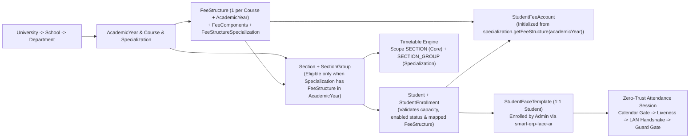

# Smart College ERP — Backend Architecture, Modules & API Specification

> **Spring Boot `4.1.0` (Java `21`) | MySQL `8.x` | Redis | STOMP/WebSocket | Python `smart-erp-face-ai` Integration**

---

## 1. End-to-End Sequential Data Flow Architecture



---

## 2. Package Reference & Core Business Logic

### 2.1. Student & Biometric Enrollment (`com.Smart.Erp.Modules.Student` & `Attendance`)

- **`Student`** (`Entity/Student.java`): Holds a bidirectional `@OneToOne(mappedBy = "student", cascade = CascadeType.ALL, orphanRemoval = true, fetch = FetchType.LAZY)` association to `StudentFaceTemplate`, with direct domain helpers:
  - `hasActiveFaceTemplate()` — verifies `"ACTIVE"` status and non-blank `encryptedEmbedding`.
  - `assignFaceTemplate(StudentFaceTemplate)` — synchronizes both sides of the `Student <-> StudentFaceTemplate` link.
  - `clearFaceTemplate()` — cleanly disassociates and orphans the stored template.
  - `mapToResponse()` — emits `hasEnrolledFace` and `faceEnrolledAt` on `StudentResponse`.
- **`FaceVerificationService`** (`Modules/Attendance/Services/FaceVerificationService.java`):
  - Enrolls/updates 128-D SFace embeddings via `PythonFaceAiClient`, encrypts embeddings via `BiometricEncryptionService` (AES-256-GCM), and syncs `student.assignFaceTemplate(...)` / `student.clearFaceTemplate()`.
  - `startVerification(...)` blocks students lacking an active face template (`student.hasActiveFaceTemplate()` or repository fallback).
- **`StudentService`** (`Modules/Student/Services/StudentService.java`):
  - `create(...)`: Validates enabled `Course` (`newEnrollmentAllowed`), `Section`, `AcademicYear`, `Specialization`, remaining section capacity using `section.getStudentCount() < section.getCapacity()`, and a valid mapped `FeeStructure` for `(specialization, academicYear)` before initializing `StudentEnrollment` and `StudentFeeAccount`.
  - `changeSection(...)`: Enforces enabled status, capacity (`getStudentCount()`), and mapped `FeeStructure` in target section's academic year.
  - `changeCourse(...)`: Validates mapped `FeeStructure` on the target `SectionGroup` and adjusts `firstFeeAccount` safely.
  - `filterSectionGroup(Long specializationId, Long academicYearId)`: Delegates to `AcademicCommonService.filterSectionGroupForStudentPage(specializationId, academicYearId)`.

### 2.2. Finance & Fee Structure (`com.Smart.Erp.Modules.Finance`)

- **`FeeStructure`** (`Entity/FeeStructure.java`):
  - Enforces uniqueness per course and academic year via `@UniqueConstraint(name = "uk_fee_structure_course_academic_year", columnNames = {"course_id", "academic_year_id"})`.
  - `createFromRequest(...)` & `updateFromRequest(...)`: Validate trimmed non-empty name, `frequency`, `totalNoOfInstallments >= 1`, at least one component, unique `FeeCategoryType` per structure, non-negative amounts, and null-safe `isMandatory` / `isRefundable` defaults.
  - `getTotalAmount()`: Null-safe summation of mandatory component amounts (`Boolean.TRUE.equals(component.getIsMandatory())`).
- **`FeeStructureService`** (`Services/FeeStructureService.java`):
  - **One Fee Structure per `(Course, AcademicYear)`**: Enforced via `FeeStructureRepo.existsByCourse_IdAndAcademicYear_Id(...)` / `existsByCourse_IdAndAcademicYear_IdAndIdNot(...)` and filtered out of `getAcademicYearFilter(Long courseId)`.
  - **University Consistency**: Rejects mismatched universities between `Course` and `AcademicYear`.
  - **Mapping Completeness**: Requires at least one enabled `Specialization` belonging to `Course`, prevents removing specializations that currently carry enrolled students in the structure's academic year, and scopes fee recalculation (`getStudentEnrollments`) strictly to `feeStructure.getAcademicYear()`.
- **`StudentFeeAccount`** (`Entity/StudentFeeAccount.java`):
  - `initializeFeeAccount(...)` resolves `sectionGroup.getSpecialization().getFeeStructure(sectionGroup.getSection().getAcademicYear())` and throws `OperationNotAllowedException` if unmapped instead of failing later with NPEs.

### 2.3. Academic & Section Flow (`com.Smart.Erp.Modules.Academic`)

- **`Specialization.getFeeStructure(AcademicYear)`**: Compares `fsa.getAcademicYear().getId()` safely against `academicYear.getId()` using `Objects.equals` (proxy-safe).
- **`SectionGroup`**:
  - `resolveMappedFeeStructure()` resolves the `(specialization, academicYear)` `FeeStructure`.
  - `mapToResponse()` populates `feeStructure` (`CommonDTO`) and `hasFeeStructure` (`Boolean`).
  - `toSectionGroupFilter()` populates `section`, `sectionGroup`, `specialization`, `courses`, `academicYear`, `department`, `school`, `university`, `feeStructure`, `capacity`, `studentCount`, and `availableSeats`.
- **`SectionService`** & **`AcademicCommonService`**:
  - `getSpecializationFilter(courseId, academicYearId)`: Returns enabled specializations in `courseId` that have a valid mapped `FeeStructure` in `academicYearId`.
  - `getEligibleSectionGroups(specializationId, academicYearId)` / `filterSectionGroupForSectionPage(...)`: Returns section groups eligible for `(specializationId, academicYearId)` with enabled statuses and a valid mapped `FeeStructure`.
  - `filterSectionGroupForStudentPage(specializationId, academicYearId)`: Additionally enforces `course.newEnrollmentAllowed == true` and open seat capacity (`section.getStudentCount() < section.getCapacity()`).

### 2.4. Timetable & Global Exception Handling

- **`TimetableController` & `AutomaticTimetableGeneratorService`**: Enforces strict separation between core `SECTION` timetables and specialization-scoped `SECTION_GROUP` timetables, contiguous 2-period practical/lab blocks, and published slot conflict checks.
- **`GlobalExceptionHandler`** (`Core/Exception/GlobalExceptionHandler.java`): Handles `ResourceNotFoundException` (`404`), `OperationNotAllowedException` (`400`), `IllegalArgumentException` (`400`), `IllegalStateException` (`409`), `FileNotFoundException` (`404`), `InvalidFileException` (`400`), `FileStorageException` (`500`), `MethodArgumentNotValidException` (`400`), and fallback exceptions (`500`) using uniform JSON `ApiErrorResponse`.

---

## 3. Controller Endpoints & DTO Reference

### 3.1. Fee Structure API (`/{role:admin|dean|school-dean|super-admin}/fee-structures`)

| Method | Endpoint | Query / Body Params | Response DTO |
| :--- | :--- | :--- | :--- |
| `GET` | `/` | — | `List<FeeStructureResponse>` |
| `POST` | `/` | `?courseId&academicYearId`, Body `FeeStructureRequest` | `FeeStructureResponse` |
| `PUT` | `/` | `?id`, Body `FeeStructureUpdateRequest` | `FeeStructureResponse` |
| `DELETE` | `/` | `?id` | `204 No Content` |
| `GET` | `/enums` | — | `FeeEnumResponse` |
| `GET` | `/specialization/filter` | `?courseId&academicYearId` | `List<CommonDTO>` |
| `GET` | `/academic-year/filter` | `?courseId` (excludes years already mapped for course) | `List<CommonDTO>` |

### 3.2. Section API (`/{role:program-coordinator|head-of-department|admin|dean|school-dean|super-admin}/sections`)

| Method | Endpoint | Query / Body Params | Response DTO |
| :--- | :--- | :--- | :--- |
| `GET` | `/` | — | `List<SectionResponse>` |
| `POST` | `/` | `?courseId&academicYearId`, Body `SectionRequest` | `SectionResponse` |
| `PUT` | `/` | `?sectionId`, Body `SectionRequest` | `SectionResponse` |
| `DELETE` | `/` | `?sectionId` | `String` |
| `GET` | `/prefix` | `?academicYearId&courseId&sectionId?` | `String` |
| `GET` | `/academic-year/filter` | `?courseId` | `List<CommonDTO>` |
| `GET` | `/specialization/filter` | `?courseId&academicYearId` (fee-mapped enabled specializations) | `List<CommonDTO>` |
| `GET` | `/groups/eligible` | `?specializationId?&academicYearId?` | `List<SectionGroupFilter>` |

### 3.3. Student & Face Enrollment APIs

**Management Controller (`/{role:head-of-department|admin|dean|super-admin}/student`):**
- `GET /` -> `List<StudentEnrollmentResponse>`
- `POST /` (multipart `details: StudentRequest`, `file?`) -> `StudentEnrollmentResponse`
- `PUT /update/enrollment/scholarship?enrollmentId&scholarshipId` -> `StudentEnrollmentResponse`
- `PUT /update/course?enrollmentId&sectionGroupId` -> `StudentEnrollmentResponse`
- `PUT /update/section?enrollmentId&sectionId` -> `StudentEnrollmentResponse`
- `PUT /update/enrollment-status?enrollmentId&enrollmentStatus` -> `StudentEnrollmentResponse`
- `GET /filter/section-groups?specializationId?&academicYearId?` -> `List<SectionGroupFilter>`
- `GET /filter/section?enrollmentId` -> `List<CommonDTO>`
- `GET /list/scholarships?sectionGroupId` -> `List<DTO>`

**Admin Face Biometrics (`/{role:head-of-department|admin|dean|super-admin}/attendance`):**
- `POST /students/{studentId}/enroll-face` (`multipart/form-data`, optional `file`) -> `Map<String, Object>`
- `POST /students/{studentId}/enroll-face/from-photo` (non-multipart registered photo extraction) -> `Map<String, Object>`
- `GET /students/{studentId}/face-status` -> `Map<String, Object>`
- `DELETE /students/{studentId}/face-template` -> `Map<String, Object>`
- `GET /students/face-status-map` -> `Map<Long, Map<String, Object>>`

**Student Portal & Attendance (`/student` & `/student/attendance`):**
- `GET /student/profile-summary`, `GET /student/photo`, `GET /student/face-template`
- `GET /student/timetable`, `GET /student/academic-calendar`, `GET /student/fees`, `GET /student/dashboard-overview`
- `POST /student/attendance/verification/start`, `POST /student/attendance/verification/{id}/challenge`
- `POST /student/attendance/handshake/verify`, `GET /student/attendance/checkin/qr`
- `GET /student/attendance/face-template`, `GET /student/attendance/history`

### 3.4. Key Request & Response DTOs

- **`FeeStructureRequest`**: `{ name, frequency, totalNoOfInstallments, specializationId: List<Long>, components: List<FeeComponentRequest> }`
- **`FeeStructureUpdateRequest`**: `{ name, frequency, totalNoOfInstallments, specializationId: List<Long>, componentToAdd, componentToRemove }`
- **`FeeStructureResponse`**: `{ id, name, frequency, totalNoOfInstallments, feeComponent: List<FeeComponentResponse>, specialization: List<CommonDTO>, courses, department, school, university, academicYear, permissionActions }`
- **`SectionGroupResponse`**: `{ id, name, code, specialization, studentCount, feeStructure, hasFeeStructure }`
- **`SectionGroupFilter`**: `{ sectionGroup, section, specialization, courses, academicYear, department, school, university, feeStructure, capacity, studentCount, availableSeats }`
- **`StudentResponse`**: `{ id, registrationNumber, basicDetailRequest, hasEnrolledFace, faceEnrolledAt }`

---

## 4. Build & Test Commands

```bash
cd backend/Smart_Erp
./mvnw test-compile
./mvnw test
```
