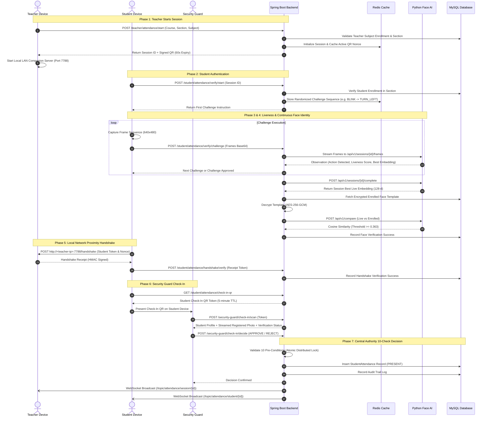

# Complete Attendance Workflow Specification
## End-to-End Operational Lifecycle

---

## 1. Sequence Overview

The secure attendance process requires strict, sequential verification across all stages. A failure at any stage immediately halts the process.

---

## 2. Phase Breakdown

### Phase 1: Teacher Starts Attendance
1. Teacher selects Academic Year, Course, Section, Subject.
2. Spring Boot validates that the teacher is formally assigned to this subject and section in the timetable.
3. System verifies no duplicate active session exists for this section.
4. Generates an HMAC-SHA256 signed QR code containing:
   - `sessionId`: Session UUID.
   - `teacherId`: Database ID of the instructor.
   - `localServerIp`: Reachable IPv4 address on the campus LAN.
   - `localServerPort`: Companion port (default 7788).
   - `timestamp`: Epoch milliseconds.
   - `nonce`: Cryptographic random string.
   - `signature`: HMAC-SHA256 signature.
5. React Teacher UI renders the QR code with an active 60-second countdown. Every 60s, a new signature and nonce are generated without terminating the ongoing session.

### Phase 2: Student Authentication & Enrollment Check
1. Student logs in with their student account and scans the Teacher QR.
2. Spring Boot verifies student identity via the JWT principal.
3. Checks `StudentEnrollmentRepo` to verify the student belongs to the specific course section. Non-enrolled students are rejected with `HTTP 403 Forbidden`.

### Phase 3: Randomized Active Face Liveness
1. Spring Boot dynamically picks 2 to 3 challenges from the pool:
   - `LOOK_STRAIGHT`
   - `BLINK_TWICE`
   - `TURN_LEFT`
   - `TURN_RIGHT`
   - `LOOK_UP`
   - `LOOK_DOWN`
2. Instructions are sent sequentially. The client cannot predict the next challenge.
3. React captures frames from the WebRTC stream at 10-15 fps.
4. Python Face AI analyzes landmark EAR (Eye Aspect Ratio) and PnP 3D head pose angles.
5. Active liveness fails if:
   - Time exceeds 15 seconds per challenge.
   - Face disappears from frame or switches bounding box abruptly.
   - MiniFASNet anti-spoof confidence falls below 0.70.

### Phase 4: Continuous Face Identity Verification
1. To prevent swapping the subject after passing liveness, Python extracts the 128-d SFace embedding directly from the highest-quality frontal frame captured *during* the verified challenge sequence.
2. Spring Boot retrieves the student's enrolled face template from `student_face_templates`.
3. Biometric template is decrypted using AES-256-GCM.
4. Python compares the two vectors using cosine similarity:
   $$\text{Similarity}(A, B) = \frac{A \cdot B}{\|A\|_2 \|B\|_2}$$
5. The calibrated threshold is **0.363**. If similarity $\ge 0.363$, identity is confirmed; otherwise, verification is aborted.

### Phase 5: Local Network Proximity Handshake
1. Student device queries the teacher's local companion server at `http://<teacher-ip>:<port>/handshake`.
2. The companion validates the student's payload format and issues a signed proximity receipt token.
3. The student submits this receipt to Spring Boot (`/student/attendance/handshake/verify`).
4. Spring Boot verifies that the student is within the valid active session window and marks the handshake verified in MySQL.

### Phase 6: Security Guard Physical Check-In
1. Student clicks "Generate Check-In QR". Spring Boot creates a single-use token valid for 5 minutes.
2. At the classroom door or campus gate, the Security Guard scans the student's QR with their device camera.
3. The Guard UI requests `/security-guard/check-in/scan`. Spring Boot returns:
   - Student Full Name, Roll Number, Enrollment Code.
   - Course, Department, and Section.
   - Face Verification Status & LAN Handshake Status.
   - Direct streaming URL to the student's verified registered ID photo (`/security-guard/check-in/student-photo/{studentId}`).
4. Guard visually matches the physical student in front of them with the registered ID photo.
5. Guard clicks **Approve** or **Reject**. If Reject is clicked, a modal forces entry of a specific reason (e.g. "Impersonation suspected", "Uniform violation", "Incorrect student ID badge").

### Phase 7: Atomic Decision & Database Recording
1. Guard decision triggers `AttendanceDecisionService.evaluateAndMarkAttendance()`.
2. A distributed lock is acquired in Redis (`lock:guard_decision:{token}`).
3. All 10 mandatory conditions are checked:
   - Session active.
   - Student enrolled in section.
   - Face liveness passed.
   - Face identity verified with similarity $\ge 0.363$.
   - LAN proximity handshake verified.
   - Guard check-in status approved.
   - Check-in token not expired.
   - Guard user authenticated and authorized.
   - No duplicate attendance record already exists.
   - Session within allowed time window.
4. Record is inserted into `student_attendances`.
5. Attendance session `present_count` is incremented.
6. Audit log entry is written to `attendance_audit_logs`.

### Phase 8: Real-Time Event Telemetry
1. WebSocket event is pushed to `/topic/attendance/session/{sessionId}`:
   - Teacher's UI live roster updates immediately with the student's name, roll number, and timestamp.
2. WebSocket event is pushed to `/topic/attendance/student/{studentId}`:
   - Student UI shows marked attendance confirmation with green celebration banner.
