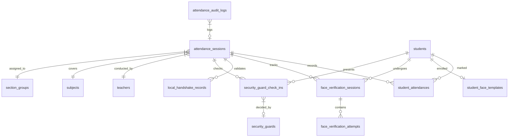

# Database Migration & Relational Schema
## MySQL 8.0 & Hibernate Entity Mapping

---

## 1. Migration Overview

The migration script `V2__secure_qr_attendance_and_guard_checkin.sql` creates all nine relational tables required for the secure attendance pipeline while preserving historical data in existing tables (`teacher_attendance`, `students`, `teachers`, `subjects`, etc.).

---

## 2. Relational Entity Relationship Diagram



---

## 3. Schema Definitions

### 1. `attendance_sessions`
Represents an instructional attendance period launched by a faculty member.
- `id` (VARCHAR(36) PK): UUID.
- `academic_year_id`, `course_id`, `section_group_id`, `subject_id`, `teacher_id`: Foreign keys with referential integrity.
- `status`: Enum (`CREATED`, `IN_PROGRESS`, `PAUSED`, `ENDED`, `EXPIRED`).
- `qr_token` (TEXT): Current HMAC-signed payload.
- `qr_nonce` (VARCHAR(64)): Active replay nonce.
- `qr_expiry_at`: Timestamp of token expiration.
- `local_server_ip` (VARCHAR(45)), `local_server_port` (INT): Teacher LAN companion endpoint.
- `total_enrolled` (INT), `present_count` (INT): Real-time metrics counters.

### 2. `student_attendances`
Final attendance ledger.
- `id` (VARCHAR(36) PK): UUID.
- `attendance_session_id`, `student_id`: Unique compound key `uk_student_attendance_session` to guarantee single-record idempotency.
- `status`: Enum (`PRESENT`, `ABSENT`, `LATE`, `REJECTED`).
- `face_verified`, `handshake_verified`, `guard_verified`: Boolean audit flags.
- `marked_at`: Final commitment timestamp.
- `remarks`: Optional notes or rejection details.

### 3. `student_face_templates`
Encrypted biometric face vectors.
- `id` (VARCHAR(36) PK): UUID.
- `student_id` (BIGINT UNIQUE FK): Student reference.
- `encrypted_embedding` (TEXT): AES-256-GCM encrypted 128-float vector (base64).
- `encryption_iv` (VARCHAR(64)): Initialization vector.
- `model_version`: SFace_v1.
- `dimension`: 128.

### 4. `face_verification_sessions`
Transient biometric challenge session.
- `id` (VARCHAR(36) PK): UUID.
- `challenges_json` (TEXT): Randomized challenge queue.
- `current_challenge_index` (INT): Active step.
- `cosine_similarity` (FLOAT): Comparison score against enrolled template.
- `similarity_threshold` (FLOAT DEFAULT 0.363): Calibrated benchmark cut-off.
- `state`: Enum (`INITIATED`, `IN_PROGRESS`, `PASSED`, `FAILED`, `EXPIRED`).

### 5. `face_verification_attempts`
Challenge audit logs (blink rate, head yaw/pitch angles per challenge).

### 6. `local_handshake_records`
Records receipt tokens from teacher LAN companion server with client IP and validation timestamps.

### 7. `security_guard_check_ins`
Student check-in tokens with 5-minute expiry, guard references, decisions (`APPROVED`/`REJECTED`), and mandatory rejection reasons.

### 8. `attendance_audit_logs`
Immutable audit log tracking all events (`SESSION_STARTED`, `LIVENESS_CHALLENGE_PASSED`, `GUARD_CHECKIN_APPROVED`, etc.) with actor ID, actor role, and IP address.

### 9. `qr_token_usages`
Stores SHA-256 hashes of redeemed teacher QR nonces to prevent token replay attacks across multiple devices.

---

## 4. Execution & Rollback Strategy

### Running the Migration
Apply the script against the MySQL instance:
```bash
mysql -u root -p smart_erp < backend/Smart_Erp/database/V2__secure_qr_attendance_and_guard_checkin.sql
```
Or place in Flyway directory: `backend/Smart_Erp/src/main/resources/db/migration/V2__secure_qr_attendance_and_guard_checkin.sql`.

### Rollback Plan
If rollback is required, drop the newly created tables in reverse dependency order without affecting legacy core tables:
```sql
DROP TABLE IF EXISTS qr_token_usages;
DROP TABLE IF EXISTS attendance_audit_logs;
DROP TABLE IF EXISTS security_guard_check_ins;
DROP TABLE IF EXISTS local_handshake_records;
DROP TABLE IF EXISTS face_verification_attempts;
DROP TABLE IF EXISTS face_verification_sessions;
DROP TABLE IF EXISTS student_face_templates;
DROP TABLE IF EXISTS student_attendances;
DROP TABLE IF EXISTS attendance_sessions;
```
