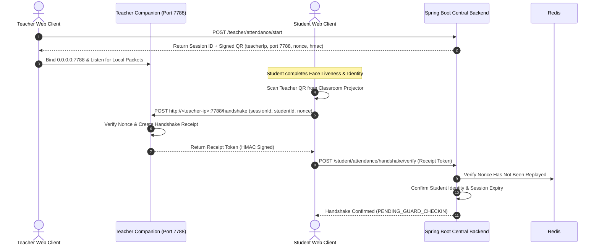

# Teacher Local Network QR Handshake
## Proximity Verification Architecture & Protocol

---

## 1. Rationale & Design Goal

GPS spoofing and screenshot forwarding make remote attendance fraud common when using standard cloud-only QR systems. To guarantee that a student is **physically co-located in the classroom**, the Smart ERP system implements a **Local Network Proximity Handshake**:

- The teacher's device establishes a lightweight HTTP companion service on the campus Wi-Fi network.
- The dynamic QR code contains the teacher's LAN IP, port, and a signed session nonce.
- The student's device makes a direct HTTP POST call over the local Wi-Fi to the teacher's companion.
- The companion validates the student's payload and issues an authenticated Proximity Receipt.
- The student forwards this receipt to Spring Boot to satisfy the handshake requirement.

> **Important Security Boundary**: Local Wi-Fi reachability is treated as a **proximity signal**, not absolute cryptographic proof of presence. It is strictly chained with Face Liveness, Face Identity, and Security Guard Check-In.

---

## 2. Architecture & Component Interaction



---

## 3. Companion Implementation Details

### A. Network Interface Resolution
The companion inspects active operating system network interfaces, skipping `127.0.0.1` and virtual bridge adapters, to select the legitimate campus IPv4 address:
```javascript
import os from "os";

export function getLocalIpAddress() {
    const interfaces = os.networkInterfaces();
    for (const name of Object.keys(interfaces)) {
        for (const iface of interfaces[name] || []) {
            if (iface.family === "IPv4" && !iface.internal) {
                return iface.address;
            }
        }
    }
    return "127.0.0.1";
}
```

### B. Teacher QR Code Payload Specification
The dynamic QR generated by Spring Boot and displayed on the teacher's screen contains the following JSON structure:
```json
{
  "sessionId": "4f9d2a6b-8711-4e78-b11c-2df5e8c14829",
  "teacherId": 14,
  "localServerIp": "192.168.1.105",
  "localServerPort": 7788,
  "timestamp": 1700900000000,
  "expiry": 1700900060000,
  "nonce": "a7b3c9f2e4d1...",
  "signature": "e3b0c44298fc1c149afbf4c8996fb92427ae41e4649b934ca495991b7852b855"
}
```

### C. Handshake Request & Receipt Verification
The student sends an authenticated request to `http://<localServerIp>:<localServerPort>/handshake`:
```json
{
  "sessionId": "4f9d2a6b-8711-4e78-b11c-2df5e8c14829",
  "studentId": 102,
  "nonce": "a7b3c9f2e4d1...",
  "clientTimestamp": 1700900015000
}
```
The companion responds with:
```json
{
  "status": "ACCEPTED",
  "receiptToken": "rcpt_7f8a9b2c3d4e...",
  "sessionId": "4f9d2a6b-8711-4e78-b11c-2df5e8c14829",
  "studentId": 102,
  "serverTime": 1700900015500
}
```

---

## 4. Replay & Spoofing Protections

1. **60-Second Dynamic QR Refresh**: The teacher QR code rotates nonces and signatures every 60 seconds. An old QR screenshot becomes invalid after 60 seconds.
2. **Single-Use Replay Nonce Tracking**: When a student redeems a handshake nonce at Spring Boot, the nonce is stored in Redis (`qr_nonce:used:{nonce}`) with a 10-minute TTL and committed to `qr_token_usages` in MySQL. Any duplicate submission is rejected.
3. **Subnet Isolation**: If a student is off-campus or connected via 4G/5G cellular data, the student device cannot route packets to `192.168.x.x` on the classroom LAN, preventing remote activation.
4. **Teacher Companion Lifecycle**: The companion process binds only during the active attendance window and shuts down automatically when the teacher clicks "End Session" or when the 15-minute lecture grace period expires.
