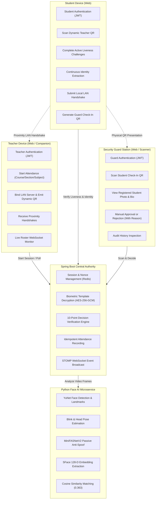

# Secure QR Attendance, Biometric Face & Security Guard Check-In
## System Architecture Specification

---

## 1. Executive Summary

This document specifies the architecture of the redesigned Attendance System within the **Smart College ERP** platform. The system completely supersedes legacy isolated attendance authenticators by unifying:

1. **Spring Boot Backend**: Central security, cryptographic authority, session orchestrator, and decision engine.
2. **Python Face AI Microservice (`smart-erp-face-ai`)**: Hardware-accelerated computer vision microservice running YuNet face detection, dense landmark tracking, active liveness challenge estimation, and SFace 128-dimensional biometric recognition.
3. **React TypeScript Frontend**: High-performance role-tailored web interfaces for Teachers, Students, and Security Guards with WebRTC camera streaming and STOMP WebSocket telemetry.
4. **Local Network Companion**: Zero-dependency teacher proximity HTTP companion running on the teacher's device to confirm physical presence on the same LAN subnet.
5. **Security Guard Verification Station**: Physical gatekeeper checkpoint module providing visual photo matching, fraud inspection, and manual approval with distributed concurrency locking.
6. **Data Tier**: MySQL 8.0 relational audit repository with AES-256-GCM biometric encryption at rest, plus Redis 7.x distributed cache and locking.

---

## 2. Actor Responsibilities & Trust Model

---

## 3. Core Component Architecture

### A. Spring Boot Central Backend (`backend/Smart_Erp`)
- **Location**: `com.Smart.Erp.Modules.Attendance`
- **Security**: Stateless JWT verification integrated with `SpringSecurity.java`. Role-based access control automatically isolates `/teacher/**`, `/student/**`, `/security-guard/**`, and `/admin/**`.
- **Biometric Encryption Service**: `BiometricEncryptionService` uses standard **AES-256-GCM** with a distinct 12-byte initialization vector (IV) per enrolled template to encrypt 128-float biometric vectors in MySQL.
- **Decision Engine**: `AttendanceDecisionService` enforces an atomic, 10-point validation checklist before any attendance row is committed to the database.
- **Distributed Concurrency**: Redis keys (`lock:guard_decision:{token}`) prevent race conditions if multiple guards scan the same student check-in simultaneously.

### B. Python Face AI Microservice (`smart-erp-face-ai`)
- **Technology**: FastAPI, OpenCV DNN, ONNX Runtime, NumPy.
- **Detection**: YuNet ONNX model (`face_detection_yunet_2023mar.onnx`) provides ultra-fast bounding boxes and 5 facial landmarks.
- **Recognition**: SFace ONNX model (`face_recognition_sface_2021dec.onnx`) extracts 128-dimensional L2-normalized feature embeddings.
- **Anti-Spoof**: MiniFASNetV2 (`2.7_80x80_MiniFASNetV2.onnx`) calculates passive spoof probabilities from multi-scale facial crops.
- **Liveness Engine**: Evaluates blink ear thresholds, head yaw/pitch/roll angles, temporal frame continuity, and face tracking persistence across challenges.

### C. React TypeScript Frontend (`frontend/Smart_Erp`)
- **Teacher Attendance Manager**: `/teacher/attendance` (`TeacherAttendanceManager.tsx`) allows faculty to pick academic year, course, section, and subject, start sessions, monitor live attendees via WebSockets, and display auto-refreshing QR codes with a 60s countdown.
- **Student Secure Attendance**: `/student/attendance` (`StudentSecureAttendance.tsx`) provides integrated QR scanner, oval camera overlay, step-by-step challenge instructions with visual animations, automated frame capture, LAN proximity submission, and Check-In QR generation.
- **Security Guard Check-In Station**: `/security-guard/check-in` (`SecurityGuardCheckIn.tsx`) equips guards with high-speed camera scanning, immediate student profile & passport photo inspection, decision buttons, and mandatory rejection reason modals.

---

## 4. Cryptographic Design & Threat Model

| Threat Scenario | Attack Vector | Architectural Countermeasure |
|---|---|---|
| **Remote Proxy Attendance** | Student at home tries to mark attendance. | **Teacher LAN Handshake**: Student device must physically exchange an authenticated packet with the teacher device on the local network subnet. |
| **Photo / Screen Replay** | Attacker holds up a phone with student's photo. | **Randomized Liveness + MiniFASNetV2**: Challenges require dynamic movements (turn left, blink twice, look up); passive model flags screen moiré and cutouts. |
| **Bait & Switch Face** | Attacker passes liveness, then swaps picture. | **Continuous Tracking & Best Frame Capture**: SFace embedding is extracted directly from high-scoring frames *within* the liveness session. Independent photo uploads are rejected. |
| **QR Code Sharing / Forwarding** | Student in class screenshots QR and sends via WhatsApp. | **60-Second Dynamic QR + HMAC-SHA256**: QR payload is signed with a secret HMAC key and expires in 60 seconds. Replay nonces are consumed immediately upon first use. |
| **Template Theft / Database Leak** | Attacker gains read-only access to MySQL dump. | **AES-256-GCM Template Encryption**: Raw biometric embeddings are never stored in plaintext. Decryption key lives strictly in Spring Boot environment variables. |
| **Security Guard Collusion** | Guard attempts to mark arbitrary students present. | **Multi-Factor Preconditions**: Guard UI cannot approve a student unless the backend confirms the student has already satisfied Face Liveness, Face Identity, and LAN Handshake. |
