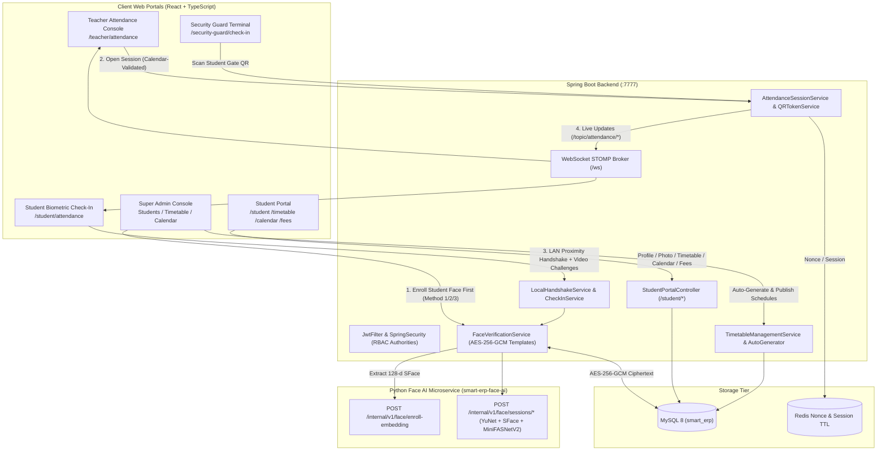
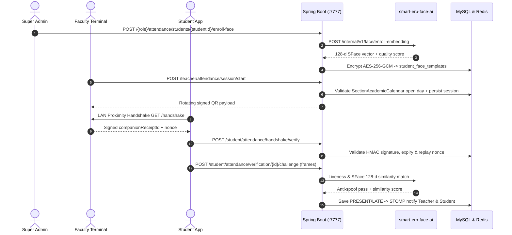
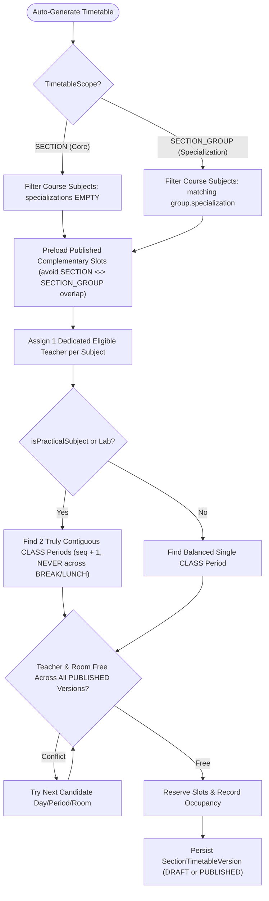

# Smart College ERP — Frontend Architecture & Technical Manual

> **Enterprise Academic Management, Zero-Trust Biometric Attendance, Conflict-Free Timetables & Student Portal**  
> **Frontend Stack:** React 18 (`^18.3.1`), TypeScript (`^5.9.2`), Vite 8 (`^8.0.2`), Tailwind CSS (`^3.4.17`), Radix UI, Axios, STOMP/SockJS WebSockets, Express (`^5.1.0`) dev proxy  
> **Backend & AI Stack:** Spring Boot `4.1.0` (Java `21`, port `7777`), MySQL `8.x`, Redis, Python FastAPI `smart-erp-face-ai` (`/internal/v1/face/*`)

---

## 1. System Architecture Overview



---

## 2. Directory Structure & Active File Map

```
frontend/Smart_Erp/
├── client/
│   ├── App.tsx                                  # Root router, ProtectedRoute role guards, Toast/Theme providers
│   ├── global.css                               # Tailwind base layers & theme CSS variables
│   ├── vite-env.d.ts                            # Vite client asset type definitions
│   │
│   ├── config/
│   │   └── RoleNavigation.ts                    # Institutional sidebar menus & route resolver (zero dead links)
│   │
│   ├── components/
│   │   ├── CommonHeader.tsx                     # Top workspace bar & responsive drawer trigger
│   │   ├── CommonFooter.tsx / Footer.tsx        # Portal and public marketing footers
│   │   ├── LandingHeader.tsx                    # Public landing navigation header
│   │   ├── PassportPhotoUpload.tsx              # Student/staff registration portrait upload (non-biometric)
│   │   ├── RoleDashboardLayout.tsx              # Shared layout framing role header + RoleSidebar
│   │   ├── RoleSidebar.tsx                      # Renders active menu from RoleNavigation.ts
│   │   ├── SuperAdminSidebar.tsx                # Full hierarchical menu for SUPER_ADMIN
│   │   ├── admin/
│   │   │   └── FaceEnrollModal.tsx              # Supervised Super Admin 3-mode biometric face enrollment modal
│   │   ├── assistant/
│   │   │   └── SmartERPChatbot.tsx              # Embedded ERP assistant widget
│   │   ├── marketing/
│   │   │   └── ModuleLandingPage.tsx            # Public feature showcase layout
│   │   ├── student/
│   │   │   ├── StatsCards.tsx                   # Live KPI cards fed by /student/dashboard-overview
│   │   │   ├── UpcomingExams.tsx                # Upcoming calendar events/exams/holidays feed
│   │   │   └── RecentNotifications.tsx          # Recent verified student attendance activity
│   │   ├── admission/, examination_department/, finance/, library/, teacher/
│   │   │   └── {StatsCards, RecentNotifications, Copilot}.tsx
│   │   └── ui/                                  # Radix UI primitives (Dialog, Select, Table, Tabs, Toast, etc.)
│   │
│   ├── hooks/
│   │   ├── useAttendanceWebSocket.ts            # STOMP + SockJS subscription hook for attendance events
│   │   ├── use-mobile.tsx                       # Responsive breakpoint helper
│   │   └── use-toast.ts                         # Toast state helper
│   │
│   ├── pages/
│   │   ├── Index.tsx, About.tsx, Features.tsx, Modules.tsx, ModulePages.tsx, AIAutomation.tsx, Solutions.tsx, Blog.tsx, Contact.tsx, Login.tsx, BookDemo.tsx, NotFound.tsx
│   │   ├── academicManagement/
│   │   │   ├── AcademicYears.tsx                # Term year CRUD
│   │   │   ├── Courses.tsx                      # Course management
│   │   │   ├── Specializations.tsx              # Course specializations
│   │   │   ├── Sections.tsx                     # Sections & specialization SectionGroups filtered by mapped FeeStructure
│   │   │   └── Subjects.tsx                     # Core vs specialization & practical/lab flags
│   │   ├── financial/
│   │   │   ├── FeeStructure.tsx                 # Fee structure (1 per course+year) & unique category validation
│   │   │   └── Scholarship.tsx                  # Scholarship waivers & discount rules
│   │   ├── organisation/
│   │   │   └── {University, School, Departments}.tsx
│   │   ├── security-guard/
│   │   │   ├── Dashboard.tsx                    # Gate operations overview
│   │   │   └── SecurityGuardCheckIn.tsx         # QR gate scanner + photo & identity comparison
│   │   ├── student/
│   │   │   ├── Dashboard.tsx                    # Student dashboard with photo, KPIs, today classes & events
│   │   │   ├── StudentSecureAttendance.tsx      # Biometric readiness guard, QR scanner, LAN handshake & camera liveness
│   │   │   ├── StudentTimetable.tsx             # Merged core SECTION + specialization SECTION_GROUP timetable & overrides
│   │   │   ├── StudentAcademicCalendar.tsx      # Section-bound academic calendar with day-type filters
│   │   │   └── StudentFees.tsx                  # Real StudentFeeAccount installments, components, scholarships & receipts
│   │   ├── teacher/
│   │   │   ├── Dashboard.tsx                    # Faculty instructional dashboard
│   │   │   ├── TeacherLayout.tsx                # Faculty shell wrapper
│   │   │   └── TeacherAttendanceManager.tsx     # Dynamic QR session host, LAN companion bridge & live roster
│   │   ├── timeTable/
│   │   │   ├── AcademicCalendar.tsx             # 1:1 section-bound calendar designer & publisher
│   │   │   ├── BaseTimeTable.tsx                # Bell periods, breaks & lunch template builder
│   │   │   ├── Room.tsx                         # Classrooms & Laboratory rooms management
│   │   │   ├── TimetableBuilder.tsx             # Scope-aware builder, 2-period lab placement & Auto-Generate modal
│   │   │   └── TimetableOverrides.tsx           # Daily faculty substitution & class cancellation workflow
│   │   ├── userMangement/
│   │   │   ├── Student.tsx                      # Student enrollment + biometric status badges + FaceEnrollModal action
│   │   │   ├── Teacher.tsx                      # Faculty profiles
│   │   │   ├── TeacherAssignRole.tsx            # Institutional role mapping
│   │   │   ├── TeacherEnrollment.tsx            # Faculty-subject allocations
│   │   │   ├── SecurityGuard.tsx                # Security personnel directory
│   │   │   └── RolePermission.tsx               # Granular RBAC matrix
│   │   └── {super-admin, admission, coordinator, counselor, dean, examination, finance, hod, hr, library}/Dashboard.tsx
│   │
│   ├── services/
│   │   ├── axiosConfig.tsx                      # Shared Axios client, base URL, JWT auth header & 401 handler
│   │   ├── authutil.tsx / authContext.tsx / authService.tsx / protectedRoute.tsx
│   │   ├── adminFaceService.ts                  # Super Admin enrollment & batch /students/face-status-map client
│   │   ├── attendanceService.ts                 # Teacher session, student challenge/handshake, guard check-in APIs
│   │   ├── studentPortalService.ts              # Student profile, photo blob, merged timetable, calendar, fees & overview
│   │   ├── academic/                            # academicYear, course, section, specialization, subject API clients
│   │   ├── financial/                           # feeStructure & scholarship API clients
│   │   ├── org/                                 # department, school, university API clients
│   │   ├── timetable/                           # baseTimetable, timetable, sectionCalendar & Room API clients
│   │   └── userMangement/                       # rolePermission, securityGuard, student, teacher, teacherEnrollment/Role
│   │
│   └── types/
│       └── auth.ts                              # JWT auth user payload & role types
│
├── scripts/
│   └── start-handshake-companion.mjs            # Zero-dependency local LAN handshake companion service
├── server/
│   ├── handshake-companion.ts                   # Embedded teacher LAN proximity signer
│   ├── index.ts                                 # Express server setup
│   └── routes/{admin, demo}.ts                  # Dev proxy/demo API routes (device punch mocks removed)
├── help.txt                                     # Senior Architect design rationale & file-by-file change audit
├── package.json                                 # Dependencies & scripts
└── vite.config.ts                               # Vite build & /api proxy configuration
```

---

## 3. Core Architecture Workflows

### 3.1. Zero-Trust Face Enrollment & Secure QR Attendance

1. **Super Admin Enrolls Face First**: Student registration collects academic details and passport photo only. Before any attendance attempt, a Super Admin opens [Student.tsx](client/pages/userMangement/Student.tsx) -> [FaceEnrollModal.tsx](client/components/admin/FaceEnrollModal.tsx) and enrolls the active `StudentFaceTemplate` via passport photo extraction, live desk webcam, or supervised high-res upload.
2. **Pre-Flight Calendar & Template Gates**: When a faculty member opens a session (`TeacherAttendanceController`), `AttendanceSessionService` checks `SectionAcademicCalendar` / `SectionCalendarDay` to block sessions on `CLOSED` holidays. When a student starts verification, `FaceVerificationService` rejects attempts unless an active `StudentFaceTemplate` exists.
3. **LAN Handshake + Live Anti-Spoof**: [StudentSecureAttendance.tsx](client/pages/student/StudentSecureAttendance.tsx) scans the teacher QR, executes a classroom LAN handshake verified via HMAC in `LocalHandshakeService`, completes randomized liveness challenges analyzed by `smart-erp-face-ai` (YuNet + SFace + MiniFASNetV2), and pushes live updates over STOMP `/topic/attendance/student/{studentId}`.



---

### 3.2. Specialization-Scoped & Conflict-Free Automatic Timetable Engine



- **No Specialization Leakage**: Specialization subjects never appear inside core `SECTION` timetables (nor in manual [TimetableBuilder.tsx](client/pages/timeTable/TimetableBuilder.tsx) slot dropdowns or automatic generation).
- **Merged Student View**: `StudentPortalController.getStudentTimetable` and `TimetableManagementService.getTimetable` merge published `SECTION` + `SECTION_GROUP` schedules alongside approved `DailyTimetableOverride` substitutions and cancellations.

---

### 3.3. Real Student Fee Ledger & Portal Integration

- `StudentPortalController` exposes `@Transactional(readOnly = true)` endpoints under `/student/*` protected by `@PreAuthorize("hasAuthority('STUDENT')")`:
  - `GET /student/profile-summary`: Academic identity, enrollment, specialization, and live `hasEnrolledFace` status.
  - `GET /student/photo`: Authenticated `Resource` stream from `BasicDetail.photo` via `FileService`.
  - `GET /student/timetable`: Merged core + group weekly slots, unique `enrolledSubjects`, and `todayView`.
  - `GET /student/academic-calendar`: Section-bound single `SectionAcademicCalendar` and day events.
  - `GET /student/fees`: Real `StudentFeeAccount` installments (`baseAmount`, `fineAmount`, `netPayableAmount`, `paidAmount`, `dueBalance`), `FeeStructure` components, `Scholarship` discounts, `StudentFeeAdjustment`s, and `FeePayment` receipts (zero mock totals).
  - `GET /student/dashboard-overview`: Live attendance %, today's classes, real fee dues, and next 60-day calendar events.

---

## 4. Development & Build Commands

### Backend (`backend/Smart_Erp/`)

```bash
cd backend/Smart_Erp
./mvnw test-compile
./mvnw test
```

### Frontend (`frontend/Smart_Erp/`)

```bash
cd frontend/Smart_Erp
npm install
npm run dev          # Vite dev server
npm run typecheck    # TypeScript check (tsc)
npm run build        # Production client bundle
```
