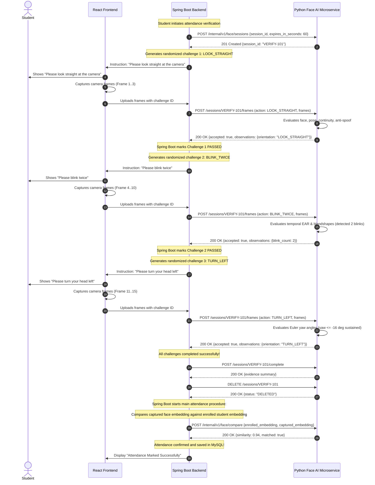

# Randomized Challenge Workflow

This document explains the end-to-end randomized challenge verification protocol used in the Smart College ERP system.

---

## 1. Architectural Authority Rules

1. **Spring Boot is the single authority.** It decides:
   - Challenge sequence and randomness.
   - Number of challenges required (e.g., 2 to 4 actions).
   - Timeouts and attempt limits.
   - Whether an action is accepted based on Python observations.
   - When to trigger biometric embedding comparison.
   - The final attendance recording in MySQL.
2. **React is the client display & camera capture device.**
   - Displays instructions sent by Spring Boot.
   - Captures short burst frame batches (e.g. 5–10 frames per action).
   - Sends frames to Spring Boot.
3. **Python is the passive computer vision engine.**
   - Evaluates whether the requested action is present in the frame batch.
   - Validates face detection (rejects 0 faces or $>1$ face).
   - Tracks eye aspect ratio (EAR) and head orientation over frames.
   - Computes passive anti-spoof scores.
   - Returns structured observations to Spring Boot.
   - **Never authorizes attendance or instructs the student.**

---

## 2. Sequence Diagram

---

## 3. Supported Challenge Actions

| Action Identifier | Requirement for Acceptance | Minimum Duration | Visual & Audio Guide |
| :--- | :--- | :--- | :--- |
| `LOOK_STRAIGHT` | $|\text{Yaw}| \le 13^\circ$ and $|\text{Pitch}| \le 13^\circ$ | Natural resting gaze | "Please look straight at the camera" |
| `BLINK_ONCE` | Exactly 1 complete eye open $\rightarrow$ closed $\rightarrow$ open cycle | $1 \le \text{closed frames} \le 12$ | "Please blink once" |
| `BLINK_TWICE` | Exactly 2 complete eye open $\rightarrow$ closed $\rightarrow$ open cycles | Two distinct cycles | "Please blink twice" |
| `TURN_LEFT` | Head turns towards user/screen left ($\text{Yaw} \ge +12^\circ$) | Sustained $\ge 1$ frame | "Please turn your head to the left" (◀ arrow) |
| `TURN_RIGHT` | Head turns towards user/screen right ($\text{Yaw} \le -12^\circ$) | Sustained $\ge 1$ frame | "Please turn your head to the right" (▶ arrow) |
| `LOOK_UP` | Head tilts chin upwards towards ceiling ($\text{Pitch} \ge +12^\circ$) | Sustained $\ge 1$ frame | "Please tilt your head up" (▲ arrow) |
| `LOOK_DOWN` | Head tilts chin downwards towards chest ($\text{Pitch} \le -12^\circ$) | Sustained $\ge 1$ frame | "Please tilt your head down" (▼ arrow) |

---

## 4. Rejection Scenarios

1. **Wrong Action**: If student blinks when asked to `TURN_LEFT`, `accepted: false` and `status: "CHALLENGE_NOT_DETECTED"`.
2. **Multiple Faces**: If a bystander appears in any frame, `status: "MULTIPLE_FACES_DETECTED"`, `accepted: false`.
3. **No Face**: If face is blocked or out of view, `status: "NO_FACE_DETECTED"`, `accepted: false`.
4. **Continuity Disruption**: If face bounding box jumps drastically between frames ($IoU < 0.20$), `status: "FACE_CONTINUITY_LOST"`, `accepted: false`.
5. **Prolonged Eye Closure**: Closed eyes $> 25$ frames transition to `PROLONGED_CLOSURE` and do **not** register as blinks.
